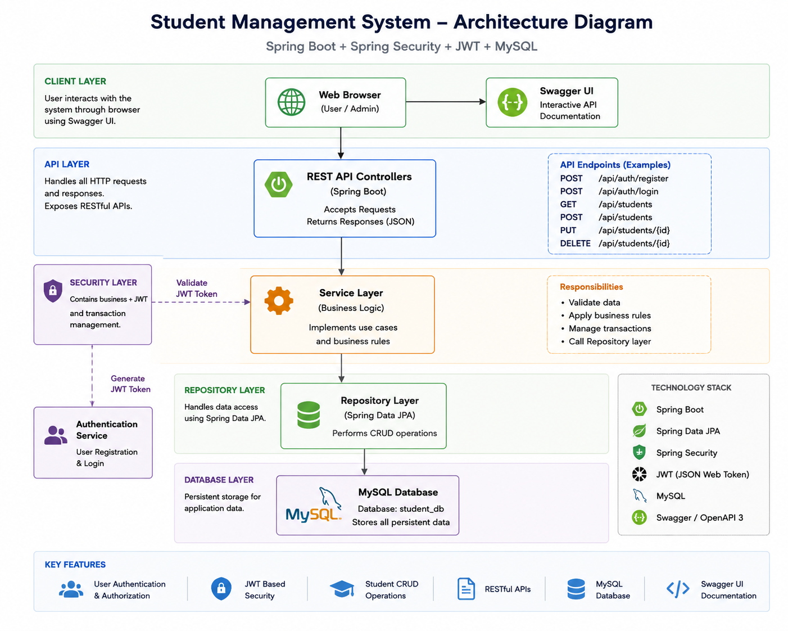

# Student Management System

A secure and containerized Student Management System built using Spring Boot, Spring Data JPA, MySQL, JWT Authentication, Swagger/OpenAPI, and Docker.

## 📌 Project Overview

The Student Management System is a backend application designed to manage student information through RESTful APIs. The application provides secure, role-based authentication using JWT and supports full student data management through protected REST APIs.

## 🚀 Features

- JWT-based authentication with stateless session management
- Role-based access control (USER, ADMIN)
- Student management with full CRUD operations
- Course, teacher, enrollment, grade and attendance management, plus a per-student report combining all of them
- Asynchronous notifications via RabbitMQ, with a dead-letter queue for failed deliveries
- Course syllabus file upload/download/delete, backed by S3-compatible object storage (SeaweedFS)
- CSV report export (all students) as an async Spring Batch job, with the result uploaded to object storage and a presigned download link
- Search, sorting, and pagination support
- MySQL database integration
- Spring Data JPA and Hibernate
- Clean DTO layer decoupling API contracts from JPA entities
- Global exception handling with custom exceptions (401 / 404 / 400 / 409 responses)
- Standardized API responses
- Swagger/OpenAPI API documentation
- Docker containerization
- Layered Spring Boot architecture

## ✅ Testing

- 290+ unit, controller, and integration tests written using JUnit 5 and Mockito
- Verified via JaCoCo (see `target/site/jacoco/index.html` after running tests)
- Covers the service layer, controllers, JWT filter/util, DTOs, entities, exception handling, database migrations and repository queries
- Database-backed tests run against a real, throwaway MySQL container via [Testcontainers](https://testcontainers.com/) - **Docker must be running**, but no local MySQL, `JWT_SECRET` or `DB_PASSWORD` is needed to run `mvn test`
- Runs automatically on every push via GitHub Actions (see `.github/workflows/ci.yml`)

## 🛠️ Tech Stack

| Technology | Usage |
|---|---|
| Java 21 | Programming Language |
| Spring Boot 3.5.4 | Backend Framework |
| Spring Data JPA | Data Access |
| Hibernate | ORM |
| MySQL 8 | Database |
| Flyway | Versioned database migrations |
| Redis | Caching (optional locally; included in `docker compose`) |
| RabbitMQ | Async domain events -> notifications (optional locally; included in `docker compose`) |
| SeaweedFS | S3-compatible object storage for course syllabus files and CSV report exports (included in `docker compose`) |
| Spring Batch | Chunk-oriented CSV report export, run as an async job rather than inline in a request |
| JWT (jjwt) | Authentication |
| Spring Security | Authorization |
| ModelMapper | Entity-DTO conversion |
| Swagger / OpenAPI | API Documentation |
| JUnit 5 + Mockito | Testing |
| JaCoCo | Test coverage reporting |
| Maven | Build Tool |
| Docker | Containerization |
| Micrometer + Prometheus | Metrics (JVM, HTTP, database pool, and student/course/enrollment counts) |
| GitHub Actions + Dependabot | CI on every push; weekly pull requests for outdated or vulnerable dependencies |
| Git & GitHub | Version Control |

## 🏗️ System Architecture

The application follows a layered architecture:

```text
Client
   │
   ▼
REST Controller (DTOs)
   │
   ▼
Service Layer (DTO ↔ Entity mapping)
   │
   ▼
Repository Layer
   │
   ▼
MySQL Database
```

### Architecture Diagram


## 🔐 Authentication

All endpoints except `/auth/login`, `/auth/refresh`, `/auth/logout`, `/users/register`, and Swagger routes require a valid JWT.

1. Register a user via `POST /users/register` (body: `username`, `email`, `password`). Public registration **always creates a `USER`**; any `role` sent by the client is ignored.
2. Log in via `POST /auth/login` (body: `username`, `password`) to receive **both** an access token and a refresh token.
3. Pass the access token on subsequent requests as a header:

```
Authorization: Bearer <token>
```

4. The access token is short-lived (15 minutes by default). Before it expires, call `POST /auth/refresh` (body: `{"refreshToken": "..."}`) to get a new access token **and** a new refresh token - the old refresh token is rotated and stops working the moment it's used, so a stolen one is only useful once.
5. `POST /auth/logout` (same body shape) revokes a refresh token. The access token itself isn't revoked; it simply expires on its own within minutes.

**Login is rate-limited** to 5 attempts per IP address per minute; further attempts get `429 Too Many Requests`. This applies per application instance - a multi-instance deployment behind a load balancer would need a shared store (Redis) for the limit to apply globally, which isn't implemented here.

## 📚 API Endpoints

### Auth

| Method | Endpoint | Access | Description |
|---|---|---|---|
| POST | `/auth/login` | Public | Authenticate and receive an access token + refresh token |
| POST | `/auth/refresh` | Public | Exchange a valid refresh token for a new token pair |
| POST | `/auth/logout` | Public | Revoke a refresh token |

### Users

| Method | Endpoint | Access | Description |
|---|---|---|---|
| POST | `/users/register` | Public | Register a new user (always role `USER`) |

### Students

| Method | Endpoint | Access | Description |
|---|---|---|---|
| GET | `/students/search` | USER, ADMIN | **Search, filter, sort and page students in one call (see below)** |
| GET | `/students` | USER, ADMIN | Get all students *(deprecated, use `/students/search`)* |
| GET | `/students/{id}` | USER, ADMIN | Get a student by ID |
| GET | `/students/search/{name}` | USER, ADMIN | Search students by name *(deprecated)* |
| GET | `/students/page?page=&size=` | USER, ADMIN | Get students with pagination *(deprecated)* |
| GET | `/students/sort/{field}` | USER, ADMIN | Get students sorted ascending by field *(deprecated)* |
| GET | `/students/sortDesc/{field}` | USER, ADMIN | Get students sorted descending by field *(deprecated)* |
| GET | `/students/pageSort?page=&size=&field=` | USER, ADMIN | Get students with pagination + sorting *(deprecated)* |
| POST | `/students` | ADMIN | Create a student |
| PUT | `/students/{id}` | ADMIN | Update a student |
| DELETE | `/students/{id}` | ADMIN | Delete a student |

#### Searching: `GET /students/search`

All parameters are optional and can be combined:

| Parameter | Meaning | Default |
|---|---|---|
| `name` | Partial, case-insensitive match on the name | (no filter) |
| `course` | Exact, case-insensitive match on the course | (no filter) |
| `minFee`, `maxFee` | Inclusive fee range | (no filter) |
| `sort` | `id`, `name`, `email`, `course` or `fee` | `id` |
| `direction` | `asc` or `desc` | `asc` |
| `page`, `size` | Page number (from 0) and page size (1-100) | `0`, `10` |

Example: `GET /students/search?name=sur&course=MCA&minFee=1000&sort=fee&direction=desc&size=5`

The result is wrapped in the usual `data` field and contains `content`, `page`, `size`, `totalElements`, `totalPages`, `first` and `last`. `minFee` greater than `maxFee` returns `400`.

**Fees** are exact decimals (never floating point): at most 10 digits before and 2 after the decimal point, and never negative.

**Limits:** `size` must be between 1 and 100 and `page` must not be negative. Sorting is allowed only by `id`, `name`, `email`, `course` or `fee`; any other field returns `400`.

**Unique e-mail:** a student's e-mail must be unique. Creating a student, or changing an e-mail, to one that another student already uses returns `409 Conflict`.

### Courses and enrollments

A student's `course` field (e.g. `"MCA"`) is a free-text label kept for backward compatibility. Separately, a student can be **enrolled** in named `Course` records that have a capacity limit and a record of when each student joined.

| Method | Endpoint | Access | Description |
|---|---|---|---|
| GET | `/courses` | USER, ADMIN | List all courses |
| GET | `/courses/{id}` | USER, ADMIN | Get a course by ID |
| POST | `/courses` | ADMIN | Create a course (`code`, `title`, `capacity`) |
| PUT | `/courses/{id}` | ADMIN | Update a course |
| DELETE | `/courses/{id}` | ADMIN | Delete a course *(fails with `409` if students are still enrolled)* |
| POST | `/courses/{id}/syllabus` | ADMIN | Upload (or replace) a course's syllabus file - PDF, Word or PowerPoint, up to 10 MB |
| GET | `/courses/{id}/syllabus` | USER, ADMIN | Get a short-lived presigned URL to download the syllabus |
| DELETE | `/courses/{id}/syllabus` | ADMIN | Delete a course's syllabus file |
| GET | `/enrollments/student/{studentId}` | USER, ADMIN | List a student's enrollments |
| GET | `/enrollments/course/{courseId}` | USER, ADMIN | List a course's enrollments |
| POST | `/enrollments` | ADMIN | Enroll a student in a course (`studentId`, `courseId`) |
| DELETE | `/enrollments/{id}` | ADMIN | Unenroll (by the enrollment's own ID) |

**Course codes are unique**, and **a student cannot be enrolled in the same course twice** - both return `409`. **A course cannot be deleted while it still has enrollments** - unenroll every student first, also `409`. **Enrolling into a full course** (enrollment count has reached its capacity) returns `409`. That last check takes a row lock on the course for the duration of the enrollment, so two requests racing for the last seat are handled one after another rather than both slipping through on stale data.

### Teachers, grades and attendance

Every course can optionally have a `Teacher` assigned. Each `Enrollment` can have one `Grade` (a score out of 100) and any number of daily `AttendanceRecord`s; a per-student report pulls all of this together.

| Method | Endpoint | Access | Description |
|---|---|---|---|
| GET | `/teachers` | USER, ADMIN | List all teachers |
| GET | `/teachers/{id}` | USER, ADMIN | Get a teacher by ID |
| POST | `/teachers` | ADMIN | Create a teacher (`name`, `email`, `department`) |
| PUT | `/teachers/{id}` | ADMIN | Update a teacher |
| DELETE | `/teachers/{id}` | ADMIN | Delete a teacher *(fails with `409` if still assigned to a course)* |
| PUT | `/courses/{id}/teacher` | ADMIN | Assign a course's teacher (`teacherId`); send `teacherId: null` to unassign |
| POST | `/grades` | ADMIN | Record (or correct) the grade for one enrollment (`enrollmentId`, `score` 0-100) |
| GET | `/grades/enrollment/{enrollmentId}` | USER, ADMIN | Get the grade for one enrollment (`data` is `null` if not graded yet) |
| GET | `/grades/student/{studentId}` | USER, ADMIN | List a student's grades across all their courses |
| POST | `/attendance` | ADMIN | Record (or correct) one day's attendance for one enrollment (`enrollmentId`, `date`, `status`: `PRESENT`, `ABSENT`, `LATE` or `EXCUSED`) |
| GET | `/attendance/enrollment/{enrollmentId}` | USER, ADMIN | List one enrollment's attendance history, oldest first |
| GET | `/students/{id}/report` | USER, ADMIN | Per-student report: every enrolled course with its grade (if any) and an attendance summary |

**A teacher's email is unique**, and **a teacher cannot be deleted while still assigned to a course** - unassign them first (`PUT .../teacher` with `teacherId: null`), also `409`. Assigning a teacher is a dedicated endpoint rather than part of the general course update, so an ordinary edit can never accidentally clear or change the assignment.

Recording a grade or an attendance entry a second time for the same enrollment (and, for attendance, the same day) **corrects the existing record instead of creating a duplicate** - a student has at most one grade per course and at most one attendance record per course per day. In the per-student report, a course's `grade` is `null` when none has been recorded yet, and `attendancePercentage` is `null` when there are zero attendance records (as opposed to `0`, which means attendance was recorded and the student was present on none of those days).

### Async notifications (RabbitMQ)

Recording a grade or an attendance entry publishes a domain event (`grade.recorded` / `attendance.recorded`) to a RabbitMQ topic exchange (`sms.events.exchange`). A listener in the same app consumes these asynchronously and writes a `Notification` row for the student - decoupling "a grade was recorded" from "something happened because of it," off the request thread that did the recording.

| Method | Endpoint | Access | Description |
|---|---|---|---|
| GET | `/notifications/student/{studentId}` | USER, ADMIN | List a student's notifications, newest first |

Publishing is a best-effort side effect, not part of the write itself: if RabbitMQ is down or unreachable, recording a grade or attendance entry still succeeds - the publish failure is logged and swallowed (see `EventPublisher`), the same "degrades gracefully" treatment `CacheConfig` gives Redis. A message the listener fails to process is routed to a dead-letter queue (`sms.notifications.queue.dlq`) after one failed attempt rather than redelivered forever or silently dropped.

Outside Docker Compose, the listener does not start automatically (`RABBITMQ_LISTENER_AUTOSTART=false` by default), so `mvn spring-boot:run` with no broker running still starts cleanly - notifications just will not be written until a broker is available and the listener is turned on. Docker Compose always has RabbitMQ, so it sets `RABBITMQ_LISTENER_AUTOSTART=true`. The RabbitMQ management UI is at `http://localhost:15672` (`guest`/`guest`) when running via Docker Compose.

### Course syllabus (S3-compatible object storage)

A course can have one syllabus file attached - a PDF, Word or PowerPoint document up to 10 MB. The file's bytes live in an S3-compatible object store, not the database; `courses` only records the object key, original filename, content type and size (see `StorageService`).

The backing server is [SeaweedFS](https://github.com/seaweedfs/seaweedfs)'s S3 gateway, not MinIO: this feature was originally built against MinIO, but MinIO discontinued free container images (pulled from both Docker Hub and quay.io) and its last free release has an unpatched critical CVE, so it's no longer run here. `StorageService` still talks to it through the `io.minio:minio` Java client library - that library is a generic S3-protocol client despite its name, and works against any S3-compatible endpoint, SeaweedFS included.

Downloading is a redirect, not a proxy: `GET /courses/{id}/syllabus` returns a short-lived **presigned URL** (10 minutes by default) that the client downloads the file from directly, the same pattern a production app would use against real S3. Uploading a new syllabus replaces the old one - the previous object is deleted from storage first, so nothing is left orphaned.

Unlike Redis and RabbitMQ above, the object store is **not** treated as an optional dependency for these three endpoints: storage is the entire point of a syllabus request, so a failure there fails that request with `502 Bad Gateway` (see `StorageException`) rather than degrading silently. It does not affect the app's overall health check, though - the rest of the API keeps working if the object store is unreachable.

The bucket (`course-syllabi` by default) is created automatically on startup if it doesn't already exist. SeaweedFS has no MinIO-style web console, so there's no UI to browse it with - only the API endpoints above.

### CSV report export (Spring Batch)

`POST /reports/students/export` kicks off an export of every student (id, name, email, course, fee, created-at) as a CSV file, run as a [Spring Batch](https://spring.io/projects/spring-batch) job rather than built in the request thread - the request returns immediately (`202 Accepted`, status `PENDING`) instead of blocking for however long the export takes.

| Method | Endpoint | Access | Description |
|---|---|---|---|
| POST | `/reports/students/export` | ADMIN | Start a student CSV export; returns immediately with status `PENDING` |
| GET | `/reports/exports/{id}` | ADMIN | Poll an export's status (`PENDING` -> `RUNNING` -> `COMPLETED`/`FAILED`) |
| GET | `/reports/exports/{id}/download` | ADMIN | Get a short-lived presigned download URL for a `COMPLETED` export |

The job reads students from the database a page at a time (so memory use stays flat regardless of table size) and writes them straight to a local CSV file; once the job finishes, a listener uploads that file to the same S3-compatible object store the course syllabus feature uses and deletes the local copy - clients never download through this app's own disk. Polling `GET /reports/exports/{id}/download` before the export has finished returns `409 Conflict`, not a broken link.

Export requests are ADMIN-only throughout (unlike most other `GET`s in this API): a student export is a bulk dump of everyone's name, email and fee, not a single record a USER has a legitimate reason to read.

### Error responses

Every error (including 401 and 403) uses the same JSON shape:

```json
{
  "timestamp": "2026-09-21T10:15:30Z",
  "status": 400,
  "error": "Bad Request",
  "message": "Validation failed",
  "errors": { "fee": "Fee cannot be negative" }
}
```

`errors` is present only for validation failures. Unexpected server errors return a generic `500` message; details are logged on the server and never sent to the client.

Full interactive API documentation is available via Swagger once the app is running, at `/swagger-ui.html`.

## ⚙️ Getting Started

### Prerequisites

- Java 21
- Maven (or use the bundled `./mvnw` / `mvnw.cmd`)
- MySQL 8, to *run* the app (not needed to run the tests)
- Docker, to *test* the app (via Testcontainers) or to run everything with `docker compose`

### Environment Variables

The application reads the following from the environment:

| Variable | Description |
|---|---|
| `DB_URL` | MySQL JDBC URL (defaults to `jdbc:mysql://localhost:3307/student_db`) |
| `DB_USERNAME` | MySQL username (defaults to `root`) |
| `DB_PASSWORD` | MySQL password |
| `JWT_SECRET` | Secret key used to sign JWTs (at least 32 characters) |
| `ADMIN_PASSWORD` | *Optional.* If set, an `ADMIN` account is created on startup (skipped if it already exists) |
| `ADMIN_USERNAME` | Admin username (defaults to `admin`) |
| `ADMIN_EMAIL` | Admin email (defaults to `admin@example.com`) |
| `JWT_ACCESS_TOKEN_EXPIRATION_MS` | Access token lifetime in ms (defaults to `900000`, 15 minutes) |
| `JWT_REFRESH_TOKEN_EXPIRATION_MS` | Refresh token lifetime in ms (defaults to `604800000`, 7 days) |
| `REDIS_HOST` | Redis host for caching (defaults to `localhost`) |
| `REDIS_PORT` | Redis port for caching (defaults to `6379`) |
| `S3_ENDPOINT` | S3-compatible endpoint for syllabus file storage (defaults to `http://localhost:8333`) |
| `S3_ACCESS_KEY` | S3 access key (defaults to `course-syllabi-app`) |
| `S3_SECRET_KEY` | S3 secret key (defaults to `change-me-course-syllabi-secret`) |
| `S3_BUCKET` | S3 bucket for syllabus files, created automatically if missing (defaults to `course-syllabi`) |
| `S3_PRESIGNED_URL_EXPIRY_SECONDS` | How long a syllabus (or report export) download URL stays valid (defaults to `600`, 10 minutes) |
| `REPORTS_EXPORT_DIR` | Local scratch directory a CSV report is staged in before upload (defaults to the JVM's own temp directory) |
| `SPRING_PROFILES_ACTIVE` | `dev` (default) or `prod` - see [Profiles](#profiles) |
| `SWAGGER_ENABLED` | Only used by the `prod` profile: `true` turns Swagger UI and `/v3/api-docs` on (defaults to `false`) |
| `CORS_ALLOWED_ORIGINS` | Comma-separated browser origins allowed to call the API from another site (defaults to `http://localhost:3000,http://localhost:5173`) |

### Profiles

| Profile | Chosen by | Behavior |
|---|---|---|
| `dev` | default (nothing set) | Readable, formatted SQL logging |
| `prod` | `SPRING_PROFILES_ACTIVE=prod` (Docker Compose sets this) | No SQL echo, one JSON log object per line, graceful shutdown, Swagger off unless `SWAGGER_ENABLED=true` |
| `test` | automated tests | Throwaway Testcontainers database, caching off |

Docker Compose turns Swagger back on so the demo stack is easy to try. For anything reachable from the internet, set `SWAGGER_ENABLED=false`.

### Request IDs and logging

Every response carries an `X-Request-Id` header, and the same ID is on every log line that request produced, so one quoted ID finds the exact request in the logs. A caller (or load balancer) may send its own `X-Request-Id`, but it is only reused if it is at most 64 characters of letters, digits, `.`, `_` or `-`; anything else is replaced with a generated one, so a crafted header cannot inject fake log lines. Rejected requests (401/403/429) get an ID too.

### Metrics

`GET /actuator/prometheus` exposes metrics in Prometheus format: JVM, HTTP, database pool, plus `sms_students`, `sms_courses` and `sms_enrollments`. It **requires an ADMIN token**, because metrics reveal internals. `/actuator/health` and `/actuator/info` stay public.

### CORS

A browser frontend on another origin can call the API only if its origin is listed in `CORS_ALLOWED_ORIGINS`. There are no wildcards and cookies are not allowed (authentication is a bearer token). Requests from Swagger UI and from tools like curl are not affected.

### Creating the first admin

Admins cannot be created through the public API. Set `ADMIN_PASSWORD` (and optionally `ADMIN_USERNAME` / `ADMIN_EMAIL`) before starting the app and it will seed the account on startup. Then log in via `/auth/login` to get an admin token.

### Database migrations (Flyway)

The database schema is managed by [Flyway](https://flywaydb.org/), not by Hibernate (`spring.jpa.hibernate.ddl-auto=none`). Migration scripts live in `src/main/resources/db/migration` and run automatically on startup:

| Script | What it does |
|---|---|
| `V1__baseline_schema.sql` | Creates `users` and `students` on a brand-new database |
| `V2__student_email_unique_and_audit.sql` | Unique student e-mail, `created_at` / `updated_at` timestamps, `version` column for optimistic locking |
| `V3__student_fee_decimal.sql` | Fee stored as `DECIMAL(12,2)` instead of `DOUBLE` |

- **Existing database** (created before Flyway was added): Flyway records it as already being at version 1 and applies only V2 onwards.
- **Never edit a migration that has already been applied.** Add a new file instead (`V3__...sql`, `V4__...sql`, ...).
- If V2 fails with `Duplicate entry ... for key 'uk_students_email'`, two students share an e-mail. Remove or change the duplicate, then start the app again; the failed `ALTER TABLE` changes nothing.

### Run locally

```bash
git clone https://github.com/suresh-1219/student-management-system.git
cd student-management-system

export DB_PASSWORD=your_db_password
export JWT_SECRET=your_jwt_secret

mvn spring-boot:run
```

The application runs on `http://localhost:9090`.

### Run with Docker Compose (recommended)

Brings up MySQL and the app together, with no local Maven or MySQL install
needed - only Docker.

```bash
cp .env.example .env
# edit .env: set DB_PASSWORD and JWT_SECRET

docker compose up --build
```

This runs the `prod` profile, with Redis for caching, RabbitMQ for async
notifications (see [Async notifications](#async-notifications-rabbitmq)) and
SeaweedFS for course syllabus files (see [Course syllabus](#course-syllabus-s3-compatible-object-storage)).
The app is then at `http://localhost:9090`, MySQL is reachable from your own
machine (e.g. Workbench) at `localhost:3307`, and the RabbitMQ management UI
is at `http://localhost:15672` (`guest`/`guest`) - all same as running
locally.
`docker compose down` stops it; add `-v` to also delete the database and object-storage volumes.

### Run with plain Docker

For running just the app image against a MySQL you already have:

```bash
docker build -t student-management-system .
docker run -p 9090:9090 \
  -e DB_URL=jdbc:mysql://host.docker.internal:3307/student_db \
  -e DB_USERNAME=root \
  -e DB_PASSWORD=your_db_password \
  -e JWT_SECRET=your_jwt_secret \
  student-management-system
```

The image is a multi-stage build (compiles inside the image, so a separate
`mvn package` step isn't needed), runs as a non-root user, and reports
health via `/actuator/health`.

### Run tests + coverage report

```bash
mvn test
```

No environment variables and no local MySQL are required - the database tests
start their own MySQL container automatically via Testcontainers. **Docker
must be running** for this to work; if it isn't, the build fails with a
message about not being able to connect to a Docker daemon.

The JaCoCo coverage report is generated at `target/site/jacoco/index.html`.

### Health check

`GET /actuator/health` (no login needed) reports whether the app and its
database connection are healthy - useful for the Docker healthcheck below,
and for a future load balancer or uptime monitor.

## 📄 License

This project was built as a personal portfolio project.
